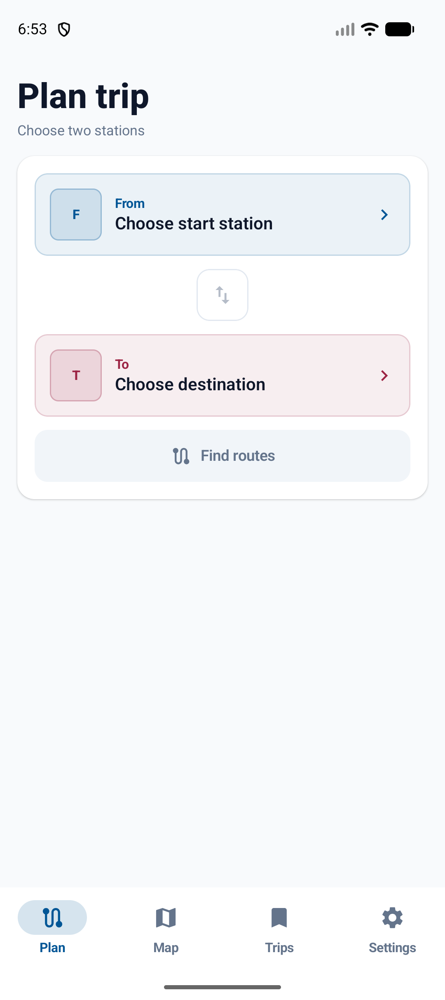
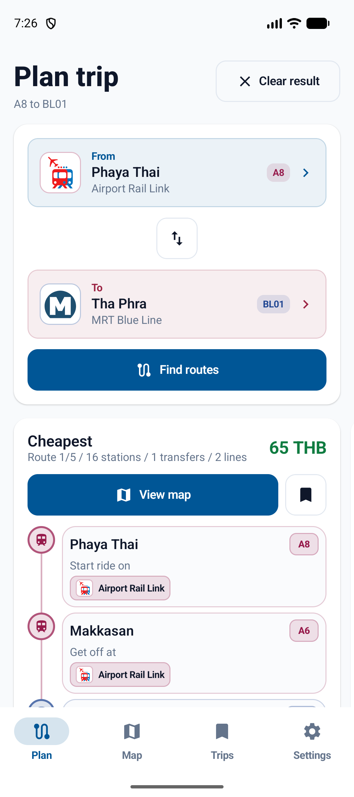
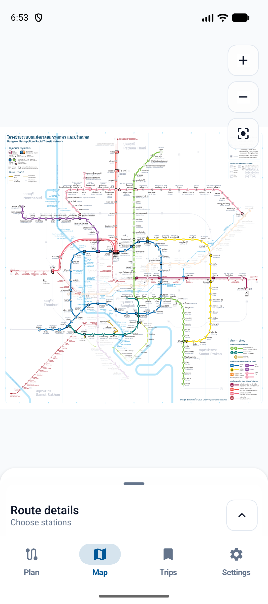
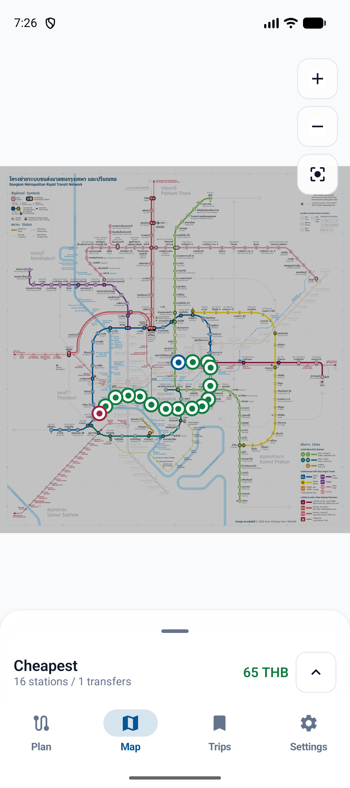
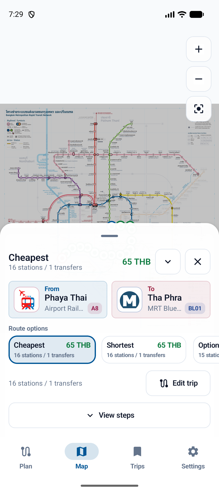
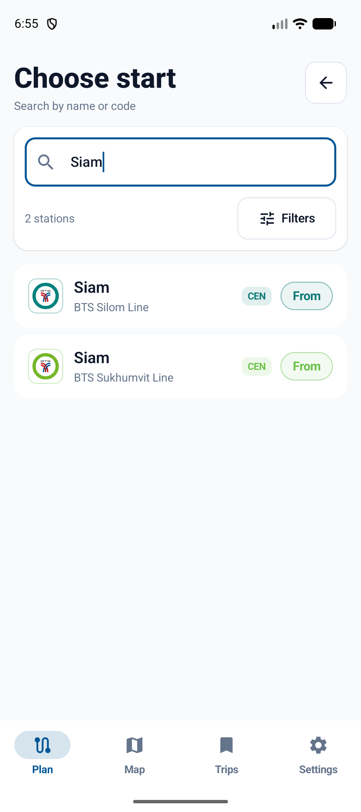
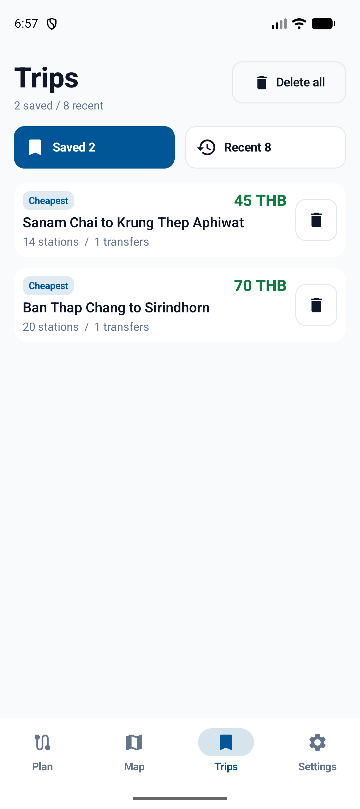
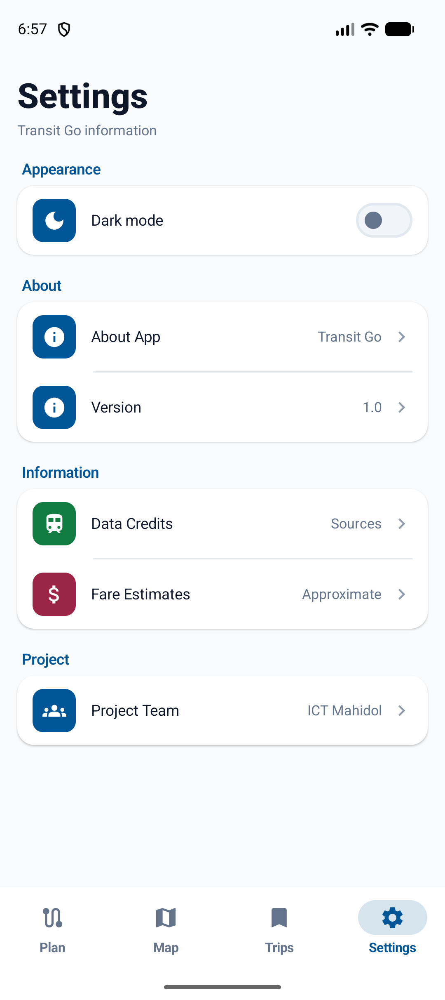

# TransitGO — Kotlin & Compose Multiplatform

This is the **`compose-multiplatform` development branch** of TransitGO, a Bangkok rail journey planner for **Android and iOS**.

- **Kotlin Multiplatform (KMP)** shares models, networking, route logic, storage logic, and UI state.
- **Compose Multiplatform (CMP)** shares the Planner, station picker, map, station details, Trips, Settings, and theme.
- Android and iOS provide their own app entry points, HTTP engines, preferences, and location services.

Features include station search and nearby suggestions, route comparisons with fares and directions, a pannable/zoomable rail map, saved and recent trips, and light/dark appearance.

This branch is for development and collaboration. Simulator builds have been checked locally; physical-device and App Store release checks are still pending.

## Contents

- [Requirements](#requirements)
- [Clone and set up](#clone-and-set-up)
- [Run Android](#run-android)
- [Run iOS in Xcode](#run-ios-in-xcode)
- [Run iOS from Android Studio](#run-ios-from-android-studio)
- [Nearby stations in a simulator or emulator](#nearby-stations-in-a-simulator-or-emulator)
- [Project structure](#project-structure)
- [Data and configuration](#data-and-configuration)
- [Troubleshooting](#troubleshooting)
- [Optional checks](#optional-checks)
- [Screen previews](#screen-previews)

## Requirements

| What you want to run | Requirements |
| --- | --- |
| Android | Android Studio on a supported Windows, Linux, or macOS machine; JDK 21; Android SDK; an emulator or Android device |
| iOS Simulator | An **Apple Silicon Mac**, full Xcode installation with an iOS simulator runtime, plus the common Gradle/JDK/Android SDK setup below |
| iOS from Android Studio | The iOS requirements above, plus a **Kotlin Multiplatform IDE plugin compatible with your Android Studio, macOS, and Xcode versions** |
| A physical iPhone | A Mac, a connected iPhone, and your own Apple signing team configured in Xcode |

You can develop and run the iOS app in Simulator without owning an iPhone. Windows and Linux can run the Android app; the iOS build needs macOS and Xcode.

Install Git before using the clone commands. The first sync/build needs internet access to download dependencies.

### Versions used by this branch

| Component | Version / setting |
| --- | --- |
| Kotlin | `2.4.20` |
| Compose Multiplatform | `1.10.3` |
| Shared Material 3 | `1.10.0-alpha05` |
| Android Gradle Plugin | `9.1.1` |
| Gradle wrapper | `9.3.1` |
| Ktor | `3.4.3` |
| Recommended Java runtime | JDK `21` |
| Android SDK platforms | API `36` for `shared`, API `36.1` for `app` |
| Minimum Android version | Android 7.0 / API `24` |
| Configured iOS deployment target | iOS `15.0`; older iOS versions have not been device-tested |
| iOS architectures | `iosArm64` and `iosSimulatorArm64` |

The iOS build has been checked on an Apple Silicon Mac with **Xcode 26.6 and an iOS 26.5 simulator**. This is a locally checked combination, not a claim that every IDE/plugin version supports it. The official [KMP compatibility guide](https://kotlinlang.org/docs/multiplatform/multiplatform-compatibility-guide.html) lists the supported toolchain combinations.

Keep the repository's pinned dependency versions for the first run. Use the included Gradle wrapper; a separate Gradle installation is unnecessary.

## Clone and set up

### 1. Clone this branch

```bash
git clone --branch compose-multiplatform https://github.com/pyaestk/TransitGO.git
cd TransitGO
```

All commands below run from this cloned repository's root unless stated otherwise.

### 2. Install Android Studio, Java, and the SDK

1. Install a current stable [Android Studio](https://developer.android.com/studio).
2. Install **JDK 21**, for example [Eclipse Temurin 21](https://adoptium.net/temurin/releases/?version=21). For iOS builds, make sure Java is also available outside Android Studio, because Xcode runs Gradle through a shell script.
3. Open the cloned **TransitGO** folder containing `settings.gradle.kts` in Android Studio.
4. In **Settings → Build, Execution, Deployment → Build Tools → Gradle**, select a JDK 21 installation as the **Gradle JDK**.
5. In **Tools → SDK Manager**, install:
   - Android SDK Platform **36** and **36.1**; enable **Show Package Details** if necessary.
   - Android SDK Build-Tools **36.0.0**.
   - Android SDK Platform-Tools.
   - Android Emulator, if you will use an Android emulator.
6. Let Gradle sync finish and accept SDK licenses if prompted.

Android Studio normally creates a local `local.properties` with your SDK path. This file is ignored by Git and must use **your own machine's SDK location**.

Check Java and Gradle from the repository root:

```bash
java -version
./gradlew --version
```

On Windows, use `gradlew.bat` instead of `./gradlew` for the Gradle commands in this guide.

### 3. Additional setup for iOS on a Mac

1. Install **Xcode** and open it once to complete its first-launch setup and accept its license.
2. In **Xcode → Settings → Components**, install an iOS simulator runtime. Some Xcode versions call this section **Platforms**.
3. Open **Window → Devices and Simulators → Simulators** and create an iPhone simulator if none exists.
4. Check the selected Xcode tools and Java installation:

```bash
xcode-select -p
xcodebuild -version
java -version
```

For a standard Xcode installation, the developer directory should be `/Applications/Xcode.app/Contents/Developer`. If the selected tools point somewhere else, select the full Xcode installation:

```bash
sudo xcode-select --switch /Applications/Xcode.app/Contents/Developer
```

If Java is missing, install JDK 21. On macOS, select an installed JDK 21 in the current terminal with:

```bash
export JAVA_HOME=$(/usr/libexec/java_home -v 21)
export PATH="$JAVA_HOME/bin:$PATH"
```

For command-line Android SDK discovery on a standard macOS installation:

```bash
export ANDROID_HOME="$HOME/Library/Android/sdk"
export PATH="$ANDROID_HOME/platform-tools:$PATH"
```

Use the path shown in your SDK Manager if you installed the SDK elsewhere. Add these exports to your shell configuration, such as `~/.zprofile`, if you want them to apply to future terminal sessions.

## Run Android

1. Open the repository root in Android Studio and wait for Gradle sync.
2. Open **Tools → Device Manager** and create/start an Android emulator, or connect an Android device with USB debugging enabled.
3. Choose **`app`** in the run-configuration dropdown.
4. Select the Android emulator or device.
5. Click **▶ Run**.

To build an APK from the repository root:

```bash
./gradlew :app:assembleDebug
```

Output: `app/build/outputs/apk/debug/app-debug.apk`.

## Run iOS in Xcode

Complete the common setup first, including Java and the Android SDK. Xcode invokes this repository's Gradle build to produce the shared framework.

From the repository root:

```bash
open iosApp/TransitGO.xcodeproj
```

Then in Xcode:

1. Select the **TransitGO** scheme.
2. Select a specific installed **iPhone simulator** as the run destination, such as **iPhone 17** or **iPhone 17 Pro**.
3. Press **⌘R**.

The **Compile Kotlin Framework** build phase builds and embeds the static `Shared` framework and Compose resources automatically. The first build downloads dependencies and compiles native code, so it may take longer than subsequent builds.

### Build iOS from Terminal

List available simulator destinations:

```bash
xcodebuild -project iosApp/TransitGO.xcodeproj -scheme TransitGO -showdestinations
```

For a simulator installed with the same name/runtime as the local development setup:

```bash
xcodebuild \
  -project iosApp/TransitGO.xcodeproj \
  -scheme TransitGO \
  -configuration Debug \
  -destination 'platform=iOS Simulator,name=iPhone 17,OS=26.5' \
  CODE_SIGNING_ALLOWED=NO \
  build
```

Replace the simulator name and OS with values from **your** destination list. This command builds the app; use **⌘R** in Xcode to install and launch it.

### Signing

Simulator builds do not need a physical iPhone or an Apple development team. For a physical iPhone, open **TARGETS → TransitGO → Signing & Capabilities**, enable **Automatically manage signing**, and select **your own team**. The project may contain the original developer's Team ID; use your own account for device signing.

## Run iOS from Android Studio

This is an alternative to launching through Xcode; Xcode is still required underneath.

1. Open **Settings → Plugins → Marketplace**.
2. Install **Kotlin Multiplatform** by JetBrains, then restart Android Studio. If already installed, check that it is enabled and updated.
3. Open the repository root and select **File → Sync Project with Gradle Files**. Wait for indexing and Xcode project import to finish.
4. Open **Project Environment Preflight Checks** from the airplane icon in the tool-window sidebar. Resolve any unsupported macOS/Xcode/IDE version warnings.
5. Choose the **TransitGO** configuration under **Xcode Application**, then choose an **iPhone simulator** in the device dropdown.
6. Click **▶ Run**.

If it does not appear automatically, check **Run → Edit Configurations…**. If the plugin offers an **Xcode Application** configuration, use target **TransitGO**, configuration **Debug**, and executable **TransitGO**.

The `app` configuration runs Android. **TransitGO** is the iOS/Xcode configuration. To see the `iosApp` folder, switch the left sidebar from **Android** view to **Project** view.

Older Android Studio/KMP plugin combinations may show only **iOS Device** with no simulators. In particular, the old Panda 2 setup reported macOS/Xcode 26.5+ as unsupported. JetBrains published [Xcode 26.6 support for newer Quail-compatible plugin builds](https://youtrack.jetbrains.com/issue/KMT-2637). Update Android Studio and its matching KMP plugin together; if IDE integration is unavailable, use the Xcode steps above.

See the official [KMP setup guide](https://kotlinlang.org/docs/multiplatform/quickstart.html) for plugin installation and preflight details.

## Nearby stations in a simulator or emulator

Nearby suggestions appear in the **From/To station picker** when the search is empty and the line filter is **All**. The app shows up to **five stations within 2 km**, ordered by approximate straight-line distance.

### iOS Simulator

1. Run the app, then bring the **Simulator** application to the foreground.
2. Select **Features → Location → Custom Location**.
3. Enter a location near Siam:

   | Field | Value |
   | --- | --- |
   | Latitude | `13.7456` |
   | Longitude | `100.5347` |

4. In TransitGO, open **Plan → From** or **To**.
5. Tap **Use my location**, allow access **While Using the App**, and keep **Precise Location** enabled.
6. If permission was already granted, tap **Refresh location** or **Try again** if needed. Stations around Siam should be suggested.

### Android Emulator

Use the emulator's **Extended Controls → Location** to set the same coordinates, then allow location access in the app and open the From/To picker.

If the simulated location is outside the Bangkok rail network, **No nearby station within 2 km** is an expected result. If access was denied, enable location permission in the simulated device's Settings. Use **Refresh stations** if the app reports missing station location data.

Location is processed locally. It is not saved in trip preferences or sent to the route API. Nearby distances use GPS latitude/longitude, separately from the illustrated map's `x`/`y` coordinates.

## Project structure

```text
app/                         Android application, ViewModel/Koin wiring, Android location
shared/
  src/commonMain/kotlin/     Shared Compose screens, models, controller, API and repositories
  src/commonMain/composeResources/
                             Map artwork, rail-line logos, bundled station data with GPS
  src/androidMain/           Android HTTP engine
  src/iosMain/               iOS entry point, HTTP engine, preferences and Core Location
  src/commonTest/            Shared nearby, networking, trip-storage and controller tests
  src/iosTest/               iOS resource-loading test
iosApp/
  TransitGO.xcodeproj/       Xcode application project
  iosApp/                   SwiftUI host and Info.plist
gradle/libs.versions.toml    Dependency and plugin versions
docs/screenshots/           Existing Android screen previews
```

Most UI and business-logic changes belong in `shared/src/commonMain`. Platform-specific location and preferences stay in their platform folders. Android retains its own app navigation and lifecycle wrapper around the shared screens/controller.

## Data and configuration

- The default backend is the hosted [Bangkok Railway API](https://bangkok-railway-api.onrender.com), configured in `BangkokRailwayApi.kt`. No local backend, `.env`, database credentials, or API key is needed for the default setup.
- Internet access is needed for live route planning, place data, and station refreshes.
- Bundled station data includes 196 stations and GPS coordinates. Station search, map artwork, and nearby-distance calculation can use bundled data when live station data is unavailable.
- Station data uses a seven-day local cache; route results use a five-minute in-memory cache.
- Saved trips and appearance preferences are stored locally on each device/simulator.

### Working with Git

Commit source, configuration, and shared resources. Build output is regenerated locally: `build/` folders, `.gradle`, `.kotlin/`, Xcode `DerivedData/`, and `xcuserdata/` are ignored.

The generated `Shared.framework` binaries can exceed 300 MB. Keep them out of commits; the repository does not need Git LFS for these generated files. A fresh clone builds its own frameworks.

## Troubleshooting

| Problem | What to check |
| --- | --- |
| `SDK location not found` | Open SDK Manager, verify the installed SDK location, and sync the project so `local.properties` points to it. |
| Java missing or wrong Gradle JDK | Install/select JDK 21, check `java -version`, and set the Gradle JDK in Android Studio. Xcode also needs a Java installation visible to its Gradle script. |
| `Permission denied: ./gradlew` on macOS/Linux | From the repository root, run `chmod +x gradlew`, then retry. |
| `iosApp` missing from the sidebar | Change **Android** view to **Project** view. The iOS folder is beside `app` and `shared`. |
| Only `iOS Device` appears in Android Studio | Check KMP preflight and update the IDE/plugin to a compatible pair. Confirm a simulator exists in Xcode. Run through Xcode if plugin integration remains unavailable. |
| `Xcode Requested Architecture Not Configured in Gradle` | This branch targets ARM64. Ensure the current Xcode project settings were imported: `ARCHS = arm64`, Debug `ONLY_ACTIVE_ARCH = YES`. Sync/reload after pulling changes and select an Apple Silicon iOS simulator. Intel simulator targets are not configured. |
| `syncComposeResourcesForIos` / provider has no value | Build the **TransitGO** Xcode application with a specific simulator selected. The resource/framework integration needs Xcode build settings; calling `syncComposeResourcesForIos` or `embedAndSignAppleFrameworkForXcode` alone from a plain terminal does not supply them. Also check the architecture settings above. |
| `No such module 'Shared'` | Build the full TransitGO Xcode app so its **Compile Kotlin Framework** phase runs. Check earlier Gradle errors for Java, SDK, architecture, or dependency failures. |
| Signing says no registered devices/profiles | Use an iPhone **simulator** for simulator development. For a physical phone, connect it and select your own signing team. |
| Nearby stations absent | Use a simulated location near Bangkok, grant location permission, clear the picker search, and select **All** lines. Read the nearby message for missing coordinates, approximate location, or no stations within 2 km. |
| Push rejected because a framework is too large | Check that generated `shared/build` files are ignored and were not staged or committed. Deleting a large file in a later commit does not remove it from earlier history. |

### Build worker fails after an IDE/JDK update

If a build reports `Failed to exec spawn helper`, quit the IDE and restart the Gradle workers from the repository root:

```bash
./gradlew --stop
```

Reopen Android Studio or Xcode and retry. This restarts build workers; it does not delete project source.

## Optional checks

Shared JVM tests and Android APK build:

```bash
./gradlew :shared:testAndroidHostTest :app:assembleDebug
```

Shared iOS tests on an Apple Silicon Mac with an installed simulator:

```bash
./gradlew :shared:iosSimulatorArm64Test
```

These automated checks do not establish physical-device or App Store readiness. Before a release, also check real-device location permissions, routing, saved trips, appearance, signing, app icons, and privacy information.

## Screen previews

Existing **Android** screenshots illustrating the app's features.

<p align="center">
  
  
  
  
</p>
<p align="center">
  
  
  
  
</p>
